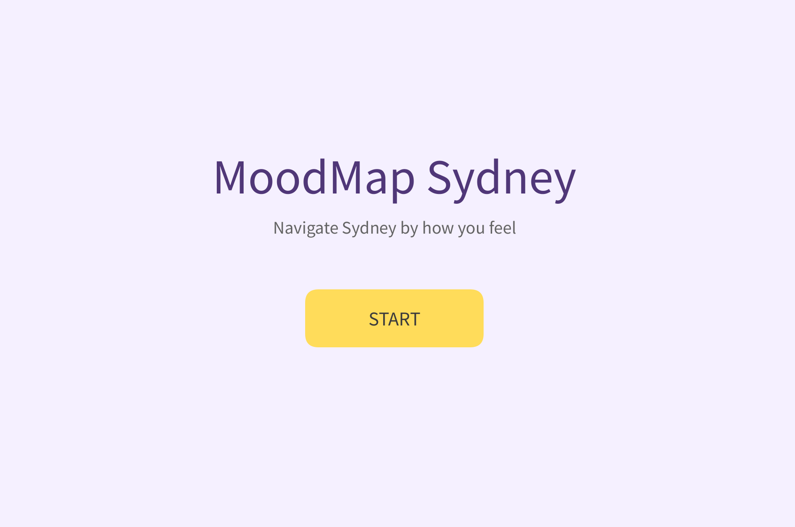
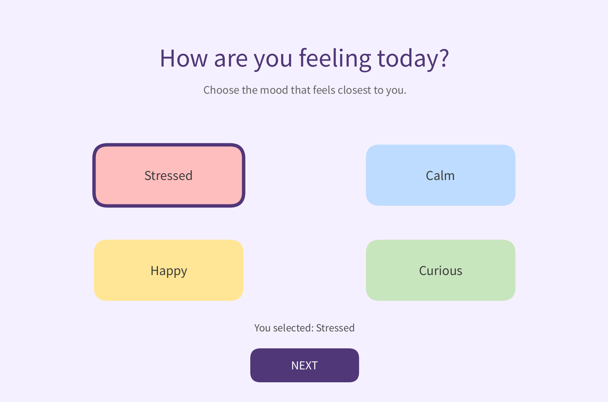
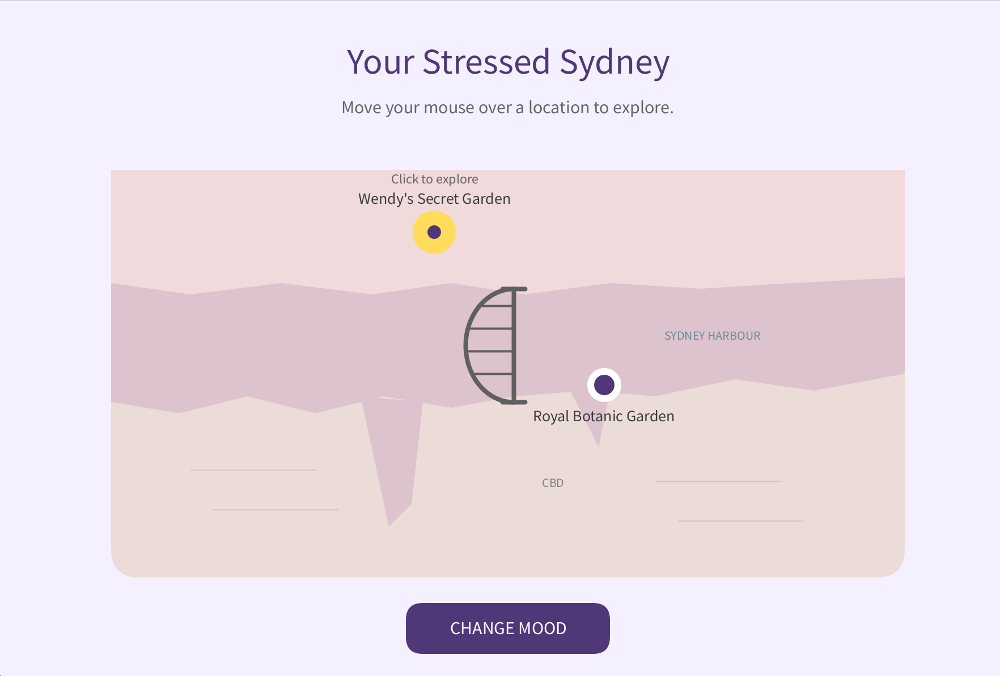
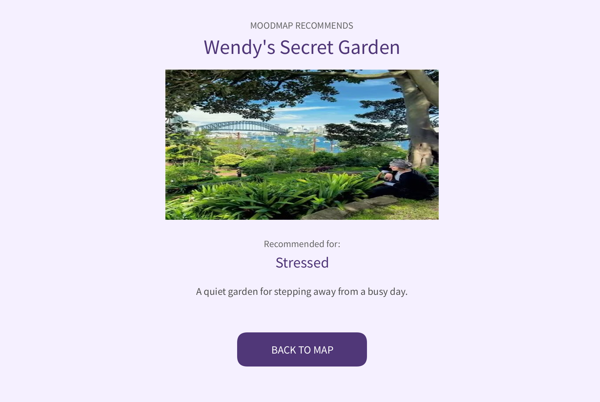

 # MoodMap Sydney
### How does Sydney feel today?

Feeling stressed and need somewhere quiet? Or feeling curious and ready to explore?

**MoodMap Sydney** is a little interactive project I created to help people discover Sydney through their moods, rather than just searching for places to visit.

## About the Project

I wanted to explore how coding could turn a simple idea into something interactive and personal.

Instead of using Google Maps, I decided to draw my own version of Sydney using Processing. It might not be geographically perfect, but that's part of its handmade style!

## Technologies Used

- Processing (Python Mode)
- Python
- Shapes, coordinates and conditional statements
- Mouse interactions

## Features

-  Choose your mood: **Stressed, Calm, Happy or Curious**
-  Discover 8 locations around Sydney
-  Watch the map change colours with your mood
-  Hover over markers to explore
-  Click to see photos and descriptions of each place

##  Screenshots

### Welcome Screen

### Mood Selection

### Interactive Map

### Location Details

##  How to Run

1. Download [Processing](https://processing.org/download).
2. Install and select **Python Mode**.
3. Download the complete project folder.
4. Open the `.pyde` file in Processing.
5. Make sure the images are inside the `data` folder.
6. Click **Run** and start exploring!

##  Project Status

**Completed prototype!**

The main interactive features are working. I also improved the map and added location photos based on feedback from my classmates.

##  What's Next?

A few things I'd love to improve:

- Make the hand-drawn map more accurate.
- Add more hidden gems around Sydney.
- Allow one location to match different moods.
- Collect more feedback on whether the recommendations match how users feel.

##  References & Credits

### Coding Resources

- [Coordinate System and Shapes – Daniel Shiffman](https://py.processing.org/tutorials/drawing/)
- [beginShape() – Processing Reference](https://py.processing.org/reference/beginshape)
- [vertex() – Processing Reference](https://py.processing.org/reference/vertex)
- [dist() – Processing Reference](https://py.processing.org/reference/dist)
- [loadImage() – Processing Reference](https://py.processing.org/reference/loadimage)
- [Interactivity – Processing.py](https://py.processing.org/tutorials/interactivity/)

### Research & Inspiration

- Hartig et al. (2014). *Nature and health*.
- Russell (1980). *A circumplex model of affect*.
- Norman (2013). *The design of everyday things*.

###  Image Credits

The location photographs used in MoodMap Sydney are credited to the following sources:

- Australian Tourism Data Warehouse. (n.d.). *Luna Park Sydney* [Photograph]. https://assets.atdw-online.com.au/images/c5f67b6617d77f62a4f1f47cc08424a9.jpeg

- dancody. (n.d.). *Sydney Chinese Garden of Friendship wallpaper* [Photograph]. Wallpapers.com. https://wallpapers.com/wallpapers/sydney-chinese-garden-of-friendship-0zhaxvzlklqqhuaj.html

- Sydney Point. (n.d.). *Art Gallery of NSW* [Photograph]. https://www.sydneypoint.com.au/wp-content/uploads/2018/01/Art-Gallery-of-NSW-03.jpg

- Visit Sydney. (n.d.-a). *Bondi Beach*. https://visitsydney.com/sydney-beaches/bondi-beach/

- Visit Sydney. (n.d.-b). *Royal Botanic Gardens Sydney*. https://visitsydney.com/attractions/royal-botanic-gardens/

- Visit Sydney. (n.d.-c). *The Rocks Sydney*. https://visitsydney.com/areas-and-neighbourhoods/the-rocks/

- Wendy's Secret Garden. (n.d.). *Wendy under fig tree* [Photograph]. https://www.wendyssecretgarden.org.au/wp-content/uploads/2017/01/wendy-under-figtree-large.jpg

- WikiAustralia. (n.d.). *Barangaroo Reserve* [Photograph]. https://wikiaustralia.com/wp-content/uploads/2025/01/Barangaroo-Reserve.jpg

- Barangaroo Reserve – WikiAustralia

##  Acknowledgements

I used [Processing.py tutorials](https://py.processing.org/tutorials/) and [Processing Reference](https://py.processing.org/reference/) to help bring my ideas to life.
